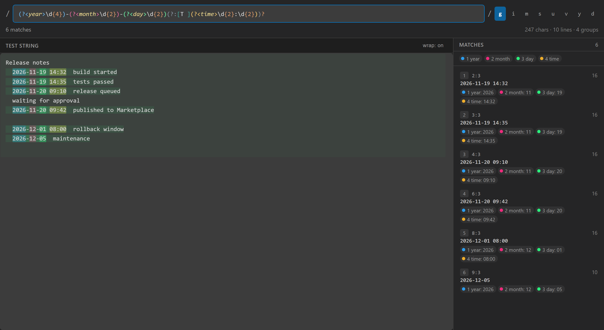

# Regex Deck

A live JavaScript regular-expression workbench for VS Code. Put the pattern on
top, paste the test text below, and watch matches, capture groups and syntax
highlighting update as you type.



## Why Regex Deck

- **See every match immediately.** Matches are highlighted in the test text;
  lines with matches get a green tint, and the active occurrence stands out.
- **Groups have colours.** Every capture group gets its own hue, both in the
  test text and in the pattern itself.
- **The pattern is highlighted too.** Groups, classes, escapes, quantifiers,
  anchors, lookarounds, inline flags and named groups are easy to tell apart.
- **Inspect the details.** The match list shows `line:column`, length and every
  captured value; click an entry to reveal it in the text.
- **No surprises.** Regex Deck uses the JavaScript (V8) engine, so a pattern
  behaves exactly as it does in `new RegExp()` inside VS Code.

## Install

From the Marketplace (after publishing):
[Regex Deck on the Visual Studio Marketplace](https://marketplace.visualstudio.com/items?itemName=mercurykd.regex-deck).

```bash
code --install-extension mercurykd.regex-deck
```

Or search for **Regex Deck** in the Extensions view. A `.vsix` can also be
installed with `code --install-extension regex-deck-<version>.vsix`.

## Usage

1. Run **Regex Deck: Open Regex Deck** from the Command Palette, or press
   <kbd>Ctrl</kbd>+<kbd>Alt</kbd>+<kbd>R</kbd>
   (<kbd>Cmd</kbd>+<kbd>Alt</kbd>+<kbd>R</kbd> on macOS).
2. Type the pattern in the top field and the test string below it.
3. Toggle flags (`g`, `i`, `m`, `s`, `u`, `v`, `y`, `d`) and inspect matches.

To start from code, select a block where the first line is the pattern
(optionally written as `/pattern/flags`) and the rest is the test text, then run
**Regex Deck: Test Selection as Regex** or use the editor context menu.

| Command | Shortcut |
| --- | --- |
| Regex Deck: Open Regex Deck | <kbd>Ctrl</kbd>+<kbd>Alt</kbd>+<kbd>R</kbd> / <kbd>Cmd</kbd>+<kbd>Alt</kbd>+<kbd>R</kbd> |
| Regex Deck: Test Selection as Regex | — |

## Supported syntax

Regex Deck runs the JavaScript flavour exactly as V8 does:

- flags `g`, `i`, `m`, `s`, `u`, `v`, `y` and `d` (`d` is added internally when
  needed for group indexes; `u` and `v` are mutually exclusive);
- named groups `(?<name>…)` and `(?P<name>…)`, backreferences `\1` and
  `\k<name>`;
- lookahead and lookbehind: `(?=)`, `(?! )`, `(?<=)`, `(?<!)`;
- inline modifiers such as `(?i:…)` and `(?im-s:…)`;
- Unicode properties `\p{Script=Greek}`, `\p{Emoji}` and `v`-mode set operations
  `[[a-z]--[aeiou]]`;
- zero-width matches, shown as thin markers.

Constructs that JavaScript does not support are not available: recursion
`(?R)`, conditionals `(?(1)…)`, atomic groups `(?>…)`, `\A`/`\z`/`\G` and
comments `(?#…)`.

## Panel features

- Live recomputation while typing, with compile errors shown in the status line.
- Soft-wrap toggle; the highlight layer stays pixel-aligned with the textarea.
- Panel state (pattern, flags, text, wrap) is restored between sessions.
- A 5,000-match safety cap keeps the panel responsive on pathological inputs.
- Group legend and per-match chips with captured values.

## Development

The extension is plain JavaScript with no build step and no runtime
dependencies.

```bash
node dev/test-core.js      # tokenizer, scanner and highlight tests
node dev/make-preview.js   # build the standalone browser preview
node dev/serve.js 8765     # open http://127.0.0.1:8765/dev/preview.html
```

To run the extension, open the folder in VS Code and press <kbd>F5</kbd>
(the launch configuration is in `.vscode/launch.json`), or run:

```bash
code --extensionDevelopmentPath=. .
```

## Release

Publishing is handled by `.github/workflows/publish.yml` and uses
[Trusted Publishing](https://code.visualstudio.com/api/working-with-extensions/publishing-extension#publish-with-github-actions-and-trusted-publishing):
GitHub Actions requests a short-lived OIDC token, so no Marketplace PAT or
secret is stored in the repository.

1. Create a Trusted Publishing policy for this repository: sign in to the
   [Marketplace publisher management page](https://marketplace.visualstudio.com/manage),
   open **mercurykd → Trusted Publishing → Create**, and use:

   | Field | Value |
   | --- | --- |
   | Policy name | `Release workflow` |
   | Repository owner | `mercurykd` |
   | Repository | `regex-deck` |
   | Workflow | `publish.yml` |
   | Environment | leave empty |

2. Bump `version` in `package.json` and add an entry to `CHANGELOG.md`.
3. Commit and push a matching tag:

```bash
git tag v0.1.0
git push origin v0.1.0
```

The workflow runs the tests, checks that the tag matches `package.json`, packages
one VSIX and then:

- publishes to the VS Code Marketplace with
  `vsce publish --oidc --skip-duplicate`;
- publishes the same VSIX to Open VSX; `OVSX_PAT` is used when present, otherwise
  the workflow tries Open VSX trusted publishing (requires a trusted publisher
  registered for this repository on open-vsx.org). An unverified Open VSX
  namespace produces a warning and does not break the release;
- attaches the VSIX to the GitHub release for the tag.

For a private repository the Marketplace policy must be used within 48 hours of
creation; the first successful publish activates it permanently.

If you prefer an approval gate, create a GitHub environment (for example
`release`) with required reviewers, add `environment: release` to the publish
job and use the same environment name in the Marketplace policy.

## License

MIT
